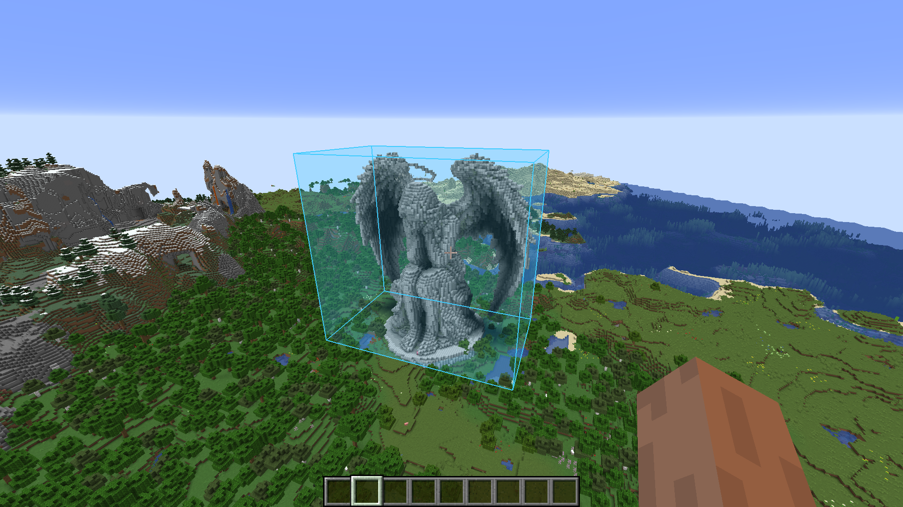
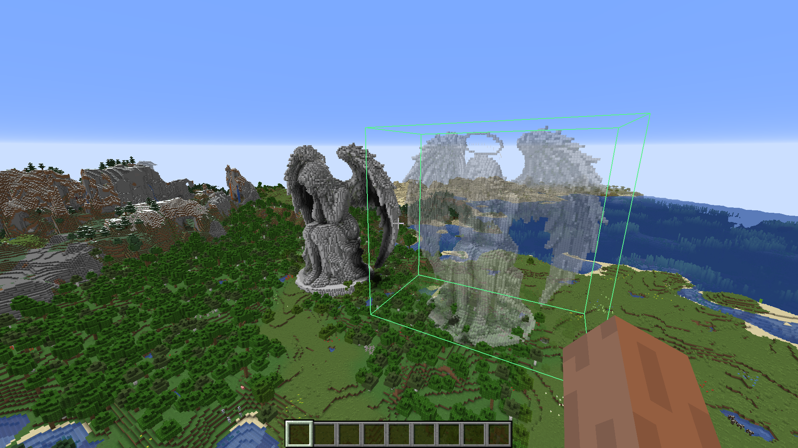
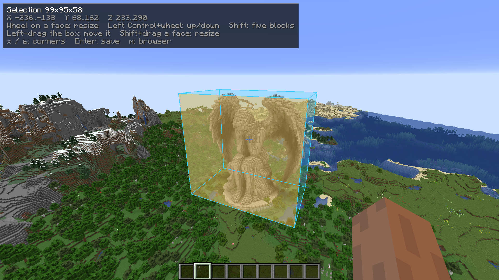
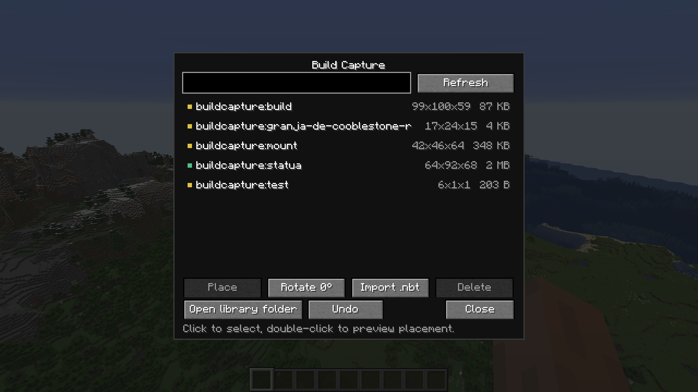
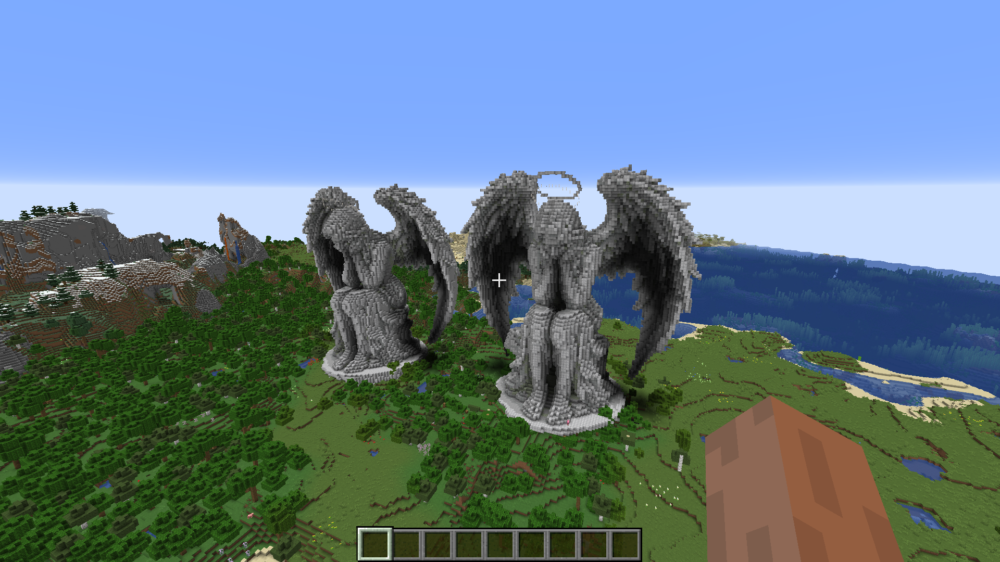

# Build Capture


[](https://modrinth.com/project/build-capture)
[](https://github.com/Tunwell1/buildcapture/releases/latest)

A Minecraft **Forge 1.16.5** mod that saves any part of your world as a normal datapack structure template. Select two corners, save the box under a name, and the result can be placed in-world, loaded by a structure block, or shipped as a datapack. The output is plain vanilla NBT, so the mod is not needed to *use* a capture.

No schematic format, no external editor, no WorldEdit.

<p align="center">
  
  
</p>

## Requirements

- Minecraft **1.16.5**
- Forge **36.2.42** or newer (1.16.x)
- Java 8 (the game itself; the Gradle build uses a newer JDK)
- Optional but recommended on the client for the box, the browser and the preview

## Installation

1. Install Forge 1.16.5.
2. Download the jar from [Releases](https://github.com/Tunwell1/buildcapture/releases/latest) (no need to clone the repository).
3. Drop `buildcapture-<version>.jar` into the `mods` folder (server, client, or both).
4. Start the game. `/capture` needs operator (permission level 2).

The server side does all the work; the mod is marked **required on the server, optional on the client**.

## Quick start

1. Aim at a block and run `/capture pos1`.
2. Aim at the opposite corner and run `/capture pos2`.
3. Run `/capture save castle/tower` — the name is free-form.
4. Press `C` (rebindable) to open the structure browser, pick the capture and press **Place** to preview it, then right-click to confirm.

## Commands

`/capture` requires permission level 2 (operator).

| Command | Description |
| --- | --- |
| `/capture pos1` / `pos2` | Set a corner to the targeted block (up to 16 blocks away). |
| `/capture expand <direction> [blocks]` | Grow the box on one side (default 1). |
| `/capture shrink <direction> [blocks]` | Shrink it from one side; the box keeps at least one block. |
| `/capture move <direction> [blocks]` | Move the whole box without changing its size. |
| `/capture save <name>` | Save the box as a datapack structure. |
| `/capture place <name> [90\|180\|270]` | Place a capture in front of you. |
| `/capture gui` | Open the structure browser (same as the `C` key). |
| `/capture list` | List captures from the world and the shared library. |
| `/capture undo` | Revert your last save, import or delete. |
| `/capture status` | Show both corners, the box size and the library folder. |
| `/capture clear` | Drop the selection. |
| `/capture reload` | Rescan and enable the capture datapack. |

Directions are `north`, `south`, `east`, `west`, `up` and `down` (north is `-Z`). Expanding is refused only if the result would leave the build height of the current dimension.

## Keys

Everything can be rebound under **Controls → "Build Capture"**.

| Key | Action |
| --- | --- |
| `[` | Set corner 1 at the targeted block (same as `/capture pos1`). |
| `]` | Set corner 2. |
| `Enter` | Save the selection. A small dialog asks for the name, pre-filled with a timestamp: Enter confirms, Esc cancels. |
| `C` | Open the structure browser. |
| `Left Alt` (hold) | Edit the selection — see [Editing the box](#editing-the-box). |

The corner/save keys run exactly the same server code as the commands, so the checks and messages are identical and the chat window is never needed.

While a placement preview is active the same Controls category holds its own bindings: `R` turns the ghost, the arrow keys move it a block, `Page Up` / `Page Down` move it vertically, the face-edit key turns it with the wheel, and a separate *Wheel changes height* key (`Left Ctrl`) moves it up or down. A plain scroll moves the build five blocks. Minecraft cannot bind the wheel itself, so only the keys held with it are bound; the rest can take combinations such as `Ctrl+R`. The on-screen hint prints whatever you have bound.

## Editing the box

Hold the face-edit key (left Alt by default). A small panel appears in the corner with the size, the coordinates and the gestures, and echoes the last step ("Moved: up", "Resizing: north").

The box behaves like an object — grab it with the left mouse button and drag. It slides on the ground plane under the cursor and keeps its height.

- The arrow keys nudge it one block, `Page Up` / `Page Down` move it vertically.
- Hold `Shift` for five-block steps.

Resizing needs a face, because a side is the only unambiguous way to say which end should grow:

- scroll over a face to push that side in or out, `Shift` for five blocks;
- `Shift`+drag a face for a freehand resize.

A face you look at straight on is pushed or pulled by looking up or down while dragging. The highlight and the outline stay visible through terrain, so faces behind walls can be grabbed too. Every step is sent to the server, which clamps it to the build height and echoes the result back — the box can never end up invalid or outside the world.

The box can also be edited while standing inside it.

## In-game browser

Press `C` (rebindable) or run `/capture gui`. The screen lists every capture from the world and the shared library with its dimensions and file size, and has a search box.

- **Place** starts a placement preview instead of dropping the build at once. The structure is drawn as translucent block models inside a green footprint box; red means it does not fit inside the build height. Only the nearest surface is drawn, so the world behind stays visible. Structures over 150,000 blocks fall back to the box alone. Right-click (or Enter) places it, middle-click or Escape cancels — nothing is written until you confirm.
- **Import .nbt** opens the system file dialog; you can also drop `.nbt` files onto the game window. The file is uploaded to the server in chunks, validated there, and written to both the world datapack and the shared library under a free id (`castle.nbt` → `buildcapture:castle`, or `buildcapture:castle_2` if taken). Only operators can import.
- **Delete** removes the entry from both places, keeping a backup, and asks for a second click first.
- **Undo** reverts your last operation — a save goes back to the version it replaced, an import is removed, a delete is restored.
- **Open library folder** opens `buildcapture_structures` in the file manager (only meaningful when the server runs on your own machine).

Uploading is capped by `capture.importMaxMb`, and everything the browser does is re-checked on the server: the client never writes files directly.

<p align="center">
  
  
</p>

## Shared library, backups and undo

Every capture is mirrored into a library outside the world (`buildcapture_structures/` in the game directory by default). The library is laid out like a datapack, is shared by every world, and can be copied into `datapacks` or a mod jar as-is.

- `/capture list` marks library-only entries with `*`.
- `/capture place` falls back to the library when the world copy is missing.
- Set `capture.libraryDir` to an absolute path to move it, or to an empty string to disable it.

Before a capture overwrites an existing structure, the old file is copied to `<world>/buildcapture_backups/<world|library>/<namespace>/<path>/`; the newest 20 backups per structure are kept. `/capture undo` reverts the last file operation of the player who ran it, handling the world and library copies together.

## Configuration

`config/buildcapture-common.toml`:

| Option | Default | Meaning |
| --- | --- | --- |
| `capture.libraryDir` | `buildcapture_structures` | Shared library folder; an empty string disables it. |
| `capture.clearAfterSave` | `true` | Drop the selection after a successful save. |
| `capture.importMaxMb` | 16 | Largest `.nbt` file the browser accepts (1–64 MB). |
| `capture.previewMaxBlocks` | 150 000 | Largest build drawn block by block in the preview (1 000–150 000); bigger builds show only the box. |
| `capture.previewTranslucent` | `true` | Draw the ghost as translucent models; `false` makes it solid. The geometry is cached either way. |

There is no per-side cap on the selection: the box is limited only by the build height.

## Multiplayer and permissions

The selection lives on the server, per player, and survives a relog; changing dimension clears it, because the corners belong to one world. The commands work with only the server mod installed; the client mod adds the box, the face highlight, mouse editing, the structure browser and the placement preview. The ghost block list is sent by the server when the preview starts, so it works on multiplayer servers too. The client and the server must run the same mod version — they compare the network protocol on join — but a client without the mod (vanilla or Forge) can still join and play; it just does not see the box or the ghost.

<p align="center">
  
</p>

## Building from source

```
gradlew.bat build
```

The jar is written to `build/libs/buildcapture-<version>.jar`. The build targets Java 8; set `JAVA_HOME` to a JDK 17 for Gradle itself (a JDK 8 is detected automatically). If yours is not, put `org.gradle.java.installations.paths=<jdk8>,<jdk17>` in `~/.gradle/gradle.properties` instead of editing the project's file.

Checks:

```
gradlew.bat test                 # unit tests for the Minecraft-free core
scripts/smoke-server.sh          # boots a dedicated dev server, fails on errors
```

The pure rules live in the `core` package with no Minecraft imports — structure names and paths, ghost-position packing, backup retention — so they are covered by unit tests and can be reused unchanged by a port to another Minecraft version. `scripts/smoke-server.sh` needs a Git Bash shell on Windows.

## License

Released under the **MIT License** — see [LICENSE.txt](LICENSE.txt) and [CREDITS.txt](CREDITS.txt). Author: Tunwell1. Minecraft is not affiliated with and does not endorse this mod.

The code, documentation and text were produced in an AI-assisted workflow, then reviewed and play-tested by the author.